# 01 · Rate limiter

**▶ Watch the video:** [Design a Rate Limiter | System Design Interview | 5 Strategies (Hindi)](https://www.youtube.com/watch?v=J5wziH5OAZM)

> Part 1 of the video: **design**. Part 2 builds all five algorithms in Node.js, runs them on Redis across two servers, breaks them, and fixes them.

**Contents:** [What it is](#what-a-rate-limiter-is) · [Where it lives](#where-the-limiter-lives) · [Fixed window](#1-fixed-window-counter) · [Sliding log](#2-sliding-window-log) · [Sliding counter](#3-sliding-window-counter) · [Token bucket](#4-token-bucket) · [Leaky bucket](#5-leaky-bucket) · [Which one when](#which-one-when) · [Distributed](#going-distributed) · [Interview extras](#interview-extras) · [The race condition](#the-bug-two-servers-one-token)

The five algorithms are taught as a chain. **Each one exists because the previous one breaks.**

**▶ [Try the live simulators](https://param4.github.io/system-design-with-param/01-rate-limiter/interactive/study-guide.html)**: send requests, fire an edge attack, and step through the race condition.

---

## What a rate limiter is

A server is just a machine. Say it handles about 100 requests a minute comfortably, slows down at 150 and crashes at 200. One buggy client stuck in a retry loop can send 10,000 requests a minute and take it down for everyone.

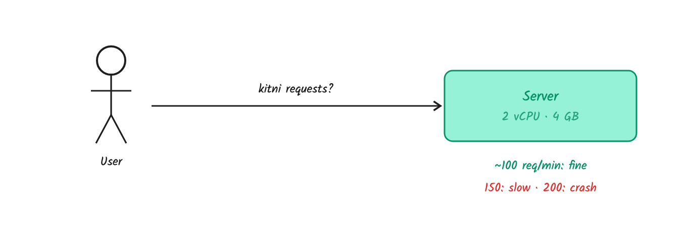

A **rate limiter** sits in front and asks one question per request: *does this caller have quota left in this time period?* If yes, the request goes through. If not, the caller gets **`429 Too Many Requests`** with a `Retry-After` header.

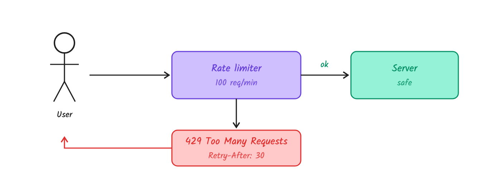

Every rule has three parts:

| Part | Examples |
|---|---|
| **Who** is counted (the key) | user ID, API key, IP, phone number |
| **How many** | 100 |
| **Per how long** | per minute |

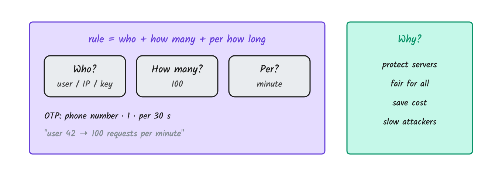

**Example: OTP over SMS.** There's no user ID before login, so the key is the **phone number**: 1 OTP per 30 s, at most 5 per hour. Real systems also limit per IP and set a global daily budget. Otherwise an attacker loops through thousands of numbers, each staying under its own limit, and you pay the SMS bill. That fraud is called *SMS pumping*.

**Why rate limit at all:**
- protect servers
- keep things fair between users
- control costs (SMS, LLM tokens, payment APIs all charge per call)
- slow down attackers

### Over the limit: reject or queue?

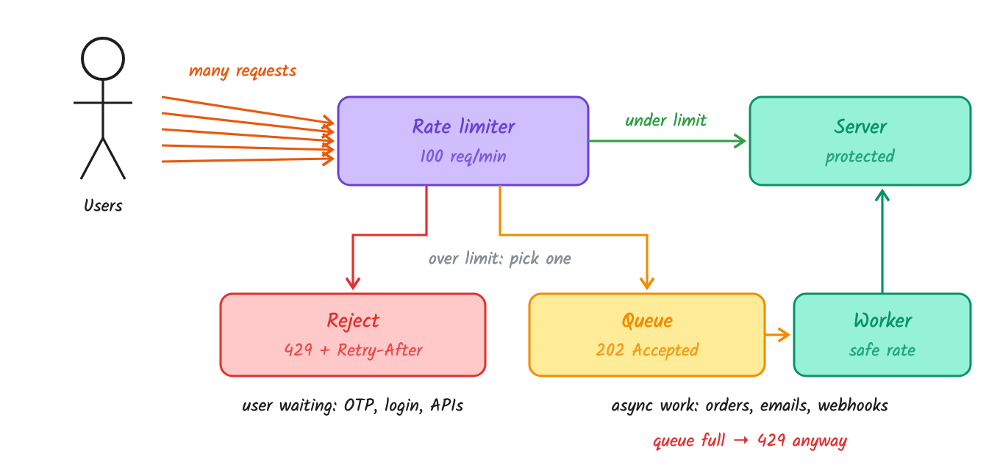

- **Reject** (`429` + `Retry-After`) when a human is waiting or the client can retry: OTP, login, public APIs.
- **Queue** (`202 Accepted`) when the work must happen but nobody is waiting on it: flash-sale orders, emails, webhooks, batch payouts.

**How the queue path works**
1. The limiter sees the request is over the limit, pushes it as a job onto a queue (Redis list or stream, SQS, Kafka) and replies `202 Accepted` with a job ID.
2. A worker pulls jobs at the rate the downstream can take. That worker is a leaky bucket (see [section 5](#5-leaky-bucket)).
3. The client polls `GET /jobs/:id`, or gets a webhook when the job is done.

**Rules that keep it safe**
- **Cap the queue. When it's full, reply 429 anyway: a queue postpones rejection, it doesn't replace it.** `IMP`
- **Only queue async work.** `IMP` Holding a synchronous HTTP request open while it waits uses up the server capacity you're protecting.
- **Expire stale jobs.** Give every job a deadline, so a two-hour-old "send OTP" never fires.
- **Make jobs idempotent.** Retries plus a queue means duplicates, so use an idempotency key.

Example: in a flash sale, rejecting orders over the limit loses money. Queue them, reply "got it, processing shortly", and let a worker place them at a rate the payment provider allows.

Related terms: *rate limiting* rejects a client over its quota. *Throttling* slows a client down. *Load shedding* drops requests when the server itself is overloaded.

## Where the limiter lives

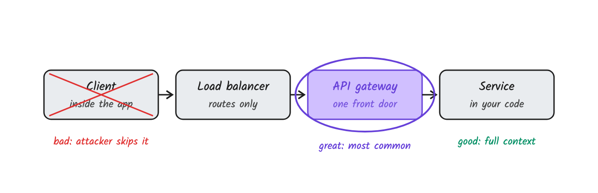

| Place | Verdict | Why |
|---|---|---|
| Client | bad | An attacker skips your app and calls the API directly |
| API gateway | great | One front door, applied before any service runs (Kong, Nginx, AWS API Gateway) |
| Inside the service | good | Full context: the user's plan, the payload |

A common answer: put the generic rules at the gateway and the business-specific rules in the service.

---

## 1. Fixed window counter

Cut time into fixed windows. Keep **one counter per user per window**. Increment it on each request and reject once it's over the limit. When the next window starts, the counter is back at 0.

```
key   = user42 : current window number
count = INCR key        # atomic in Redis
allow = count <= LIMIT
```

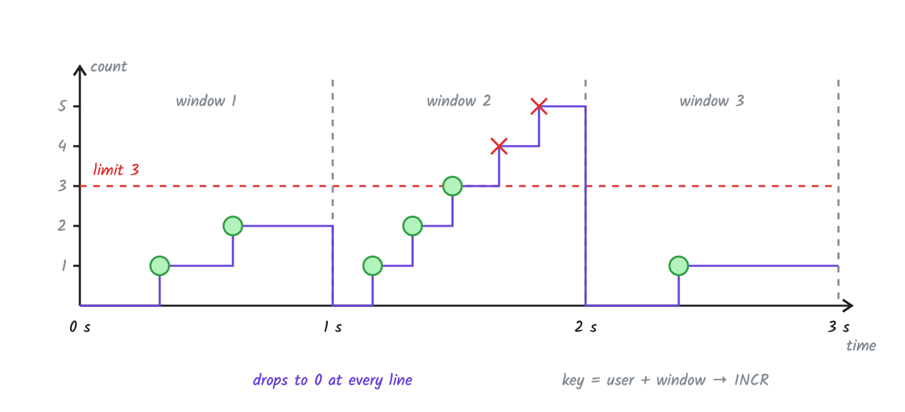

### The bug: the edge attack

The limit is 100 per minute. A client sends 100 requests at 0:59 and 100 more at 1:01. Each window sees exactly 100, so all 200 pass, within 2 seconds. **The worst case is 2× the limit in any 60-second span**, because the counter forgets everything at the boundary.

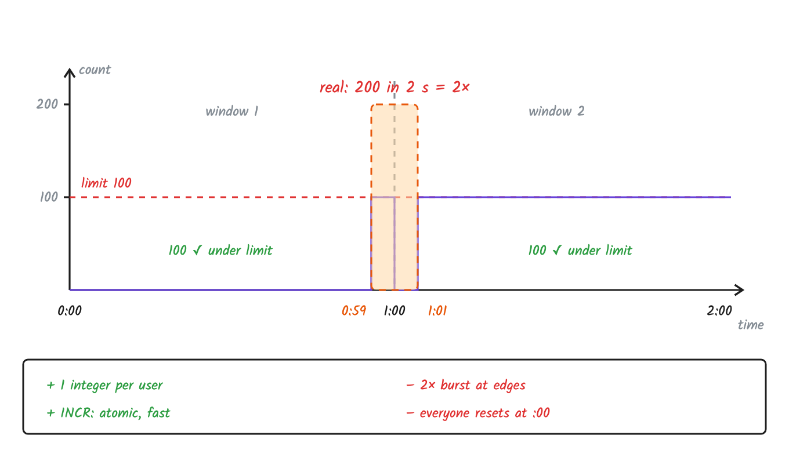

| Pros | Cons |
|---|---|
| 1 integer per user | 2× burst at window edges |
| `INCR` is atomic and fast | everyone's window resets at :00 (thundering herd) |

### Redis gotcha: the key that never expires

The usual fixed-window code is two separate commands:

```
count = INCR user42:10:01            # creates the key at 1, with no expiry yet
if count == 1: EXPIRE user42:10:01 60
```

If the app crashes or restarts right after `INCR`, `EXPIRE` never runs. The key now has **no TTL**:

- **Key has the window number** (like `user42:10:01`): the next minute uses a new key, so the user is fine. But the old key stays in Redis **forever**. Millions of these leak memory until Redis fills up.
- **Key is just `user42`** (the window starts at the first request): the key never resets, the count only grows, and after 100 requests user42 gets 429 **forever**, until someone deletes the key by hand.

**Fix:** create the key with its expiry in one command, then increment:

```
SET  user42:10:01 0 EX 60 NX         # only if missing, and with a TTL in the same command
INCR user42:10:01                    # INCR keeps the existing TTL
```

A crash between these two is harmless, because the key already has its TTL. Or do `INCR` + `EXPIRE` together in one Lua script, which Redis runs as one atomic step.

## 2. Sliding window log

Store the **timestamp of every request**. On each new request, drop timestamps older than *now − window*, then count what's left. The window slides with the clock, so there is no boundary to exploit.

Worked example, limit 3 per 2 s, requests at 0.3, 0.8, 1.6, 2.5, 2.9 and 3.4 s:

- 0.3 s and 0.8 s fall out of the window as time moves on.
- At 3.4 s the window [1.4, 3.4] already holds **1.6, 2.5, 2.9**. That's 3, so the request is **rejected**.

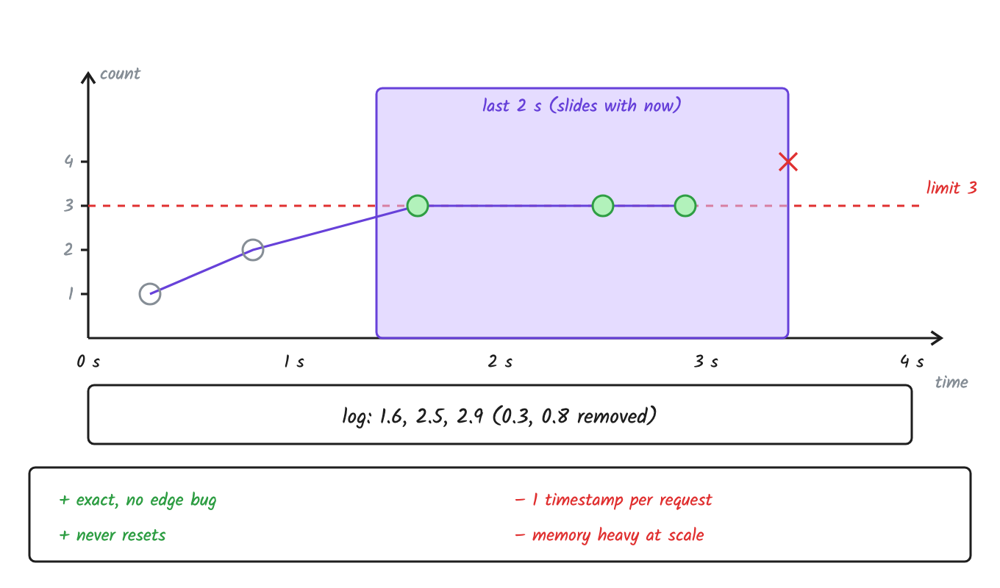

| Pros | Cons |
|---|---|
| exact, no edge bug | 1 timestamp per request |
| count never resets | memory heavy at scale |

Interview question: should *rejected* requests be logged too? If yes, a client that keeps hammering stays blocked. That's harsher on abusers and also harsher on normal users.

### In Redis: a sorted set per user

The score of each entry is the request's timestamp. Limit 100 per 60 s:

```
ZREMRANGEBYSCORE user42 0 (now - 60)    # drop entries older than the window
ZCARD user42                            # how many are left? say 99
ZADD user42 now req-id                  # 99 < 100, so record this request
EXPIRE user42 60
```

**The race:** two servers handle user42 at the same moment. Both run `ZCARD`, both see 99, both decide "one slot left", and both `ZADD`. The set now holds 101, so the limit is broken. With 10 servers it can overshoot by up to 9.

**Fix:** run the check and the add as one Lua script. Redis runs it start to finish with nothing in between:

```lua
-- KEYS[1] = user key, ARGV = now (s), window (s), limit, unique request id
redis.call('ZREMRANGEBYSCORE', KEYS[1], 0, ARGV[1] - ARGV[2])
if redis.call('ZCARD', KEYS[1]) < tonumber(ARGV[3]) then
  redis.call('ZADD', KEYS[1], ARGV[1], ARGV[4])
  redis.call('EXPIRE', KEYS[1], ARGV[2])
  return 1
end
return 0
```

## 3. Sliding window counter

Keep only **two counters**, the previous window and the current one, and estimate the count over the last window:

```
estimate = previous × (overlap % of previous window) + current
```

Limit 10 per minute, 8 requests in the previous minute, 3 so far in this one, 25% into the current minute: 8 × 75% + 3 = **9 → allowed**.

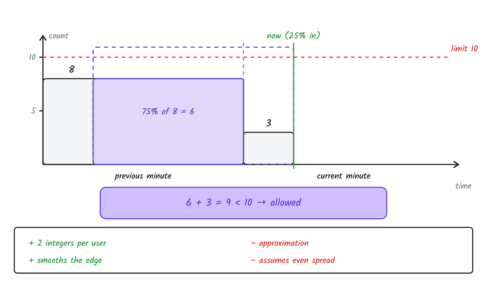

It assumes the previous window's requests were evenly spread. Cloudflare reported that only **0.003% of 400 million requests** were wrongly allowed or limited with this approach.

| Pros | Cons |
|---|---|
| 2 integers per user | an approximation |
| smooths the edge burst | assumes an even spread |

**But:** all three window algorithms treat a burst as bad. Real apps fire about 10 calls the moment they open (profile, feed, notifications). That's normal, and it should be allowed.

## 4. Token bucket

A bucket holds up to **capacity** tokens and is refilled at a **fixed rate**. Each request takes one token. An empty bucket means 429. Capacity sets the largest burst, and the refill rate sets the long-run average. Used by Stripe and AWS API Gateway.

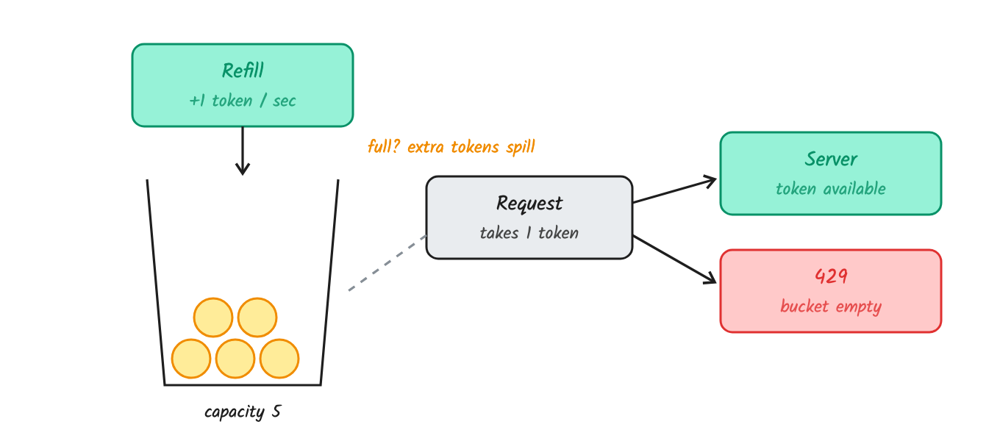

### Lazy refill: no timer

Don't run a background job that adds tokens to millions of buckets. **Store just two numbers per key, `tokens` and `last_time`, and compute the refill when a request arrives.** `IMP`

```
tokens = min(capacity, tokens + (now - last_time) * rate)
```

Capacity 5, refill 1 token per second:

| time | elapsed | tokens after refill | request | left |
|---|---|---|---|---|
| 0 s | – | 5 (full) | 5 requests ✓ | 0 |
| 0.5 s | 0.5 s | 0.5 | 1 request ✗ 429, retry in 0.5 s | 0.5 |
| 3 s | 2.5 s | 3 | 1 request ✓ | 2 |
| 20 s | 17 s | min(5, 19) = 5 | – | 5 |

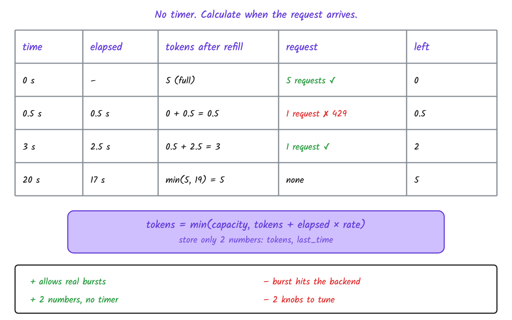

| Pros | Cons |
|---|---|
| allows real-world bursts | the burst hits your backend all at once |
| 2 numbers per key, no timer | 2 knobs to tune |

## 5. Leaky bucket

Requests join a fixed-size **queue**, and a worker takes them out at a **constant rate**. Bursty in, smooth out. If the queue is full, the request is dropped. Think of an overhead water tank feeding a shower. Used by Shopify's API and Nginx `limit_req`.

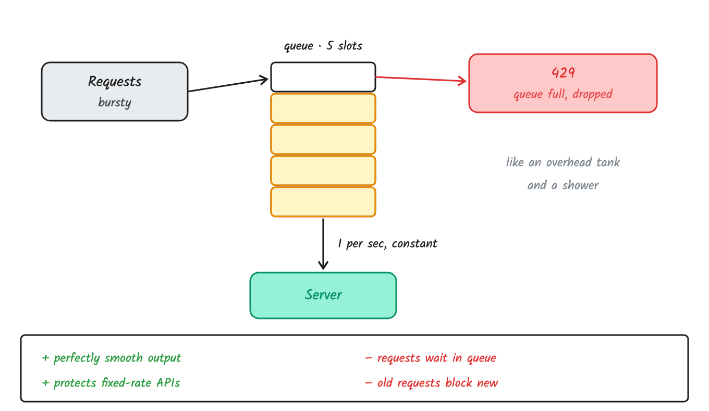

| Pros | Cons |
|---|---|
| perfectly smooth output | requests wait in the queue |
| protects fixed-rate downstreams | old requests can block new ones |

"Leaky bucket" has two meanings. **As a queue** (shown here) it shapes traffic. **As a meter** it's a counter that drains at a fixed rate, which is the mirror image of token bucket.

---

## Which one when

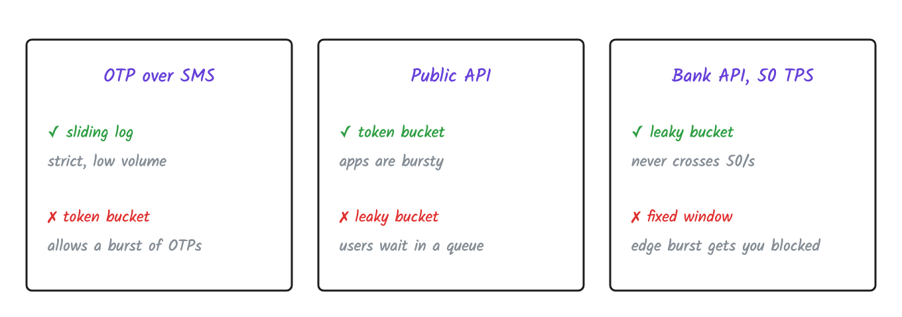

| Scenario | Pick | Not this | Why not |
|---|---|---|---|
| OTP over SMS | sliding log | token bucket | allows a burst of OTPs |
| Public API (Stripe-style) | token bucket | leaky bucket | users would wait in a queue |
| Calling a bank API capped at 50 TPS | leaky bucket | fixed window | an edge burst gets you blocked |

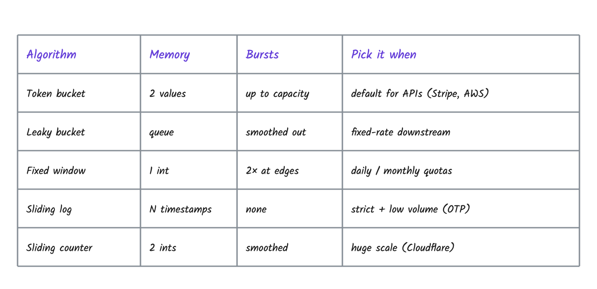

## Going distributed

With 2+ servers behind a load balancer, per-server counters give a user N × the limit. Move the counters to a **shared store**. Redis is in-memory, fast, supports TTLs, and has atomic `INCR` and Lua scripts. Sticky sessions also work but hurt scaling and failover.

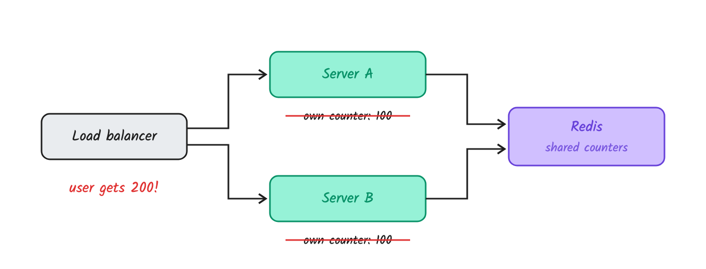

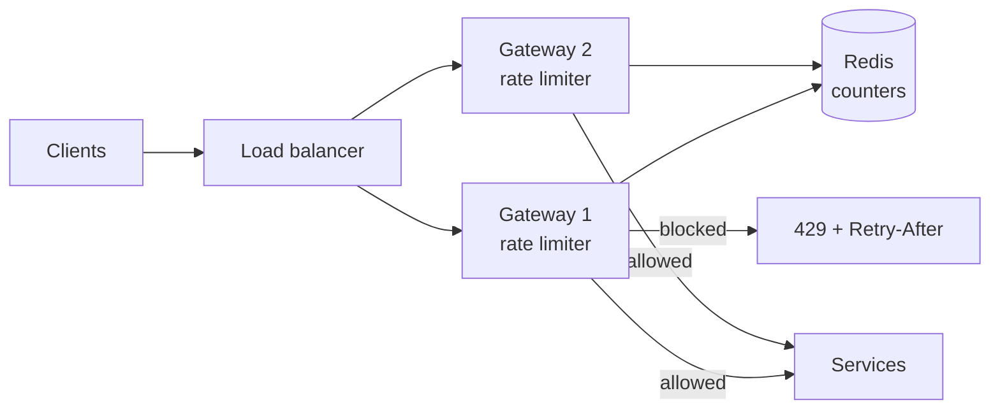

## Interview extras

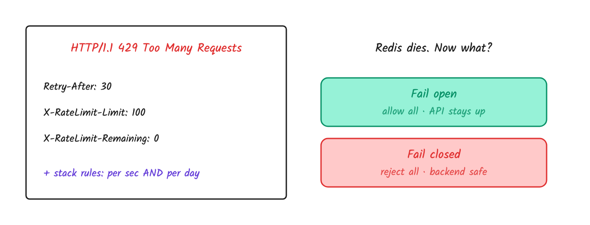

- **Tell the client:** `Retry-After` (standard, RFC 9110), plus the de facto `X-RateLimit-Limit` and `X-RateLimit-Remaining`.
- **Redis goes down:** you either **fail open** (allow all; the API stays up, at some risk) or **fail closed** (reject all; the backend is safe but the API is down). Most public APIs fail open, and money-critical paths fail closed. Say which you'd pick and why.
- **Stack rules:** per second *and* per day, per phone *and* per IP.
- **Hard vs soft limits:** a soft limit lets requests through but alerts. That's useful when rolling out a new limit.
- **Clients:** back off exponentially *with jitter*, or everyone retries at the same instant.

## The bug: two servers, one token

A user has 1 token left. Two requests hit two servers at the same moment. Both read `tokens = 1` from Redis before either writes, so both allow. **1 token, 2 requests.** You'll never see this in local testing.

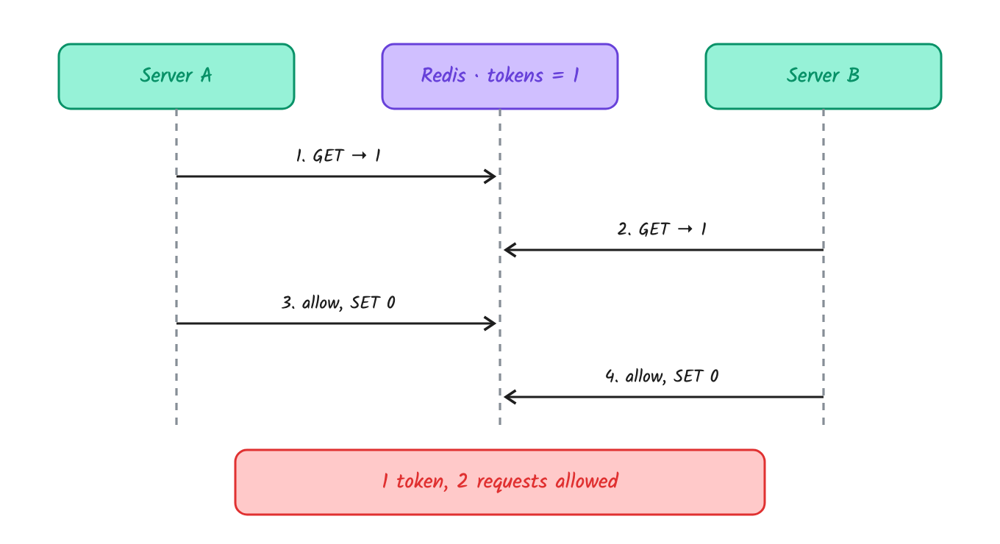

The fix is to do the read-check-write as **one atomic Lua script** inside Redis. That's Part 2, where we write it in Node.js, break it first, then fix it.

---

### Sources

- [ByteByteGo: Design a rate limiter](https://bytebytego.com/courses/system-design-interview/design-a-rate-limiter)
- [Stripe: Scaling your API with rate limiters](https://stripe.com/blog/rate-limiters)
- [Cloudflare: Counting things, a lot of different things](https://blog.cloudflare.com/counting-things-a-lot-of-different-things/)
- [Figma: An alternative approach to rate limiting](https://www.figma.com/blog/an-alternative-approach-to-rate-limiting/)
- [GitHub: Sharded, replicated rate limiter in Redis](https://github.blog/engineering/how-we-scaled-github-api-sharded-replicated-rate-limiter-redis/)
- RFC 6585 (429), RFC 9110 (`Retry-After`)
